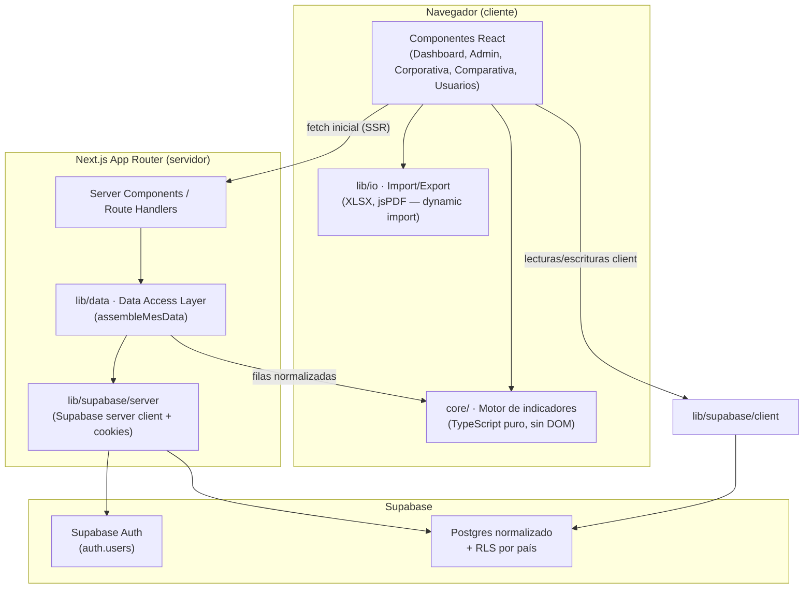
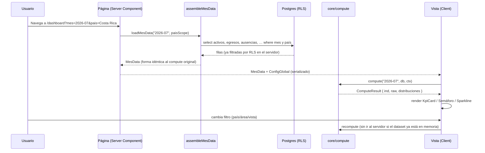
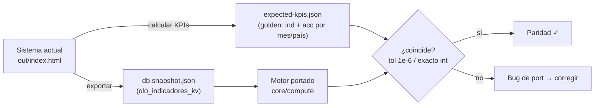
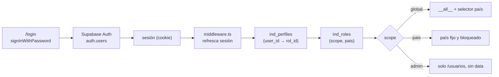
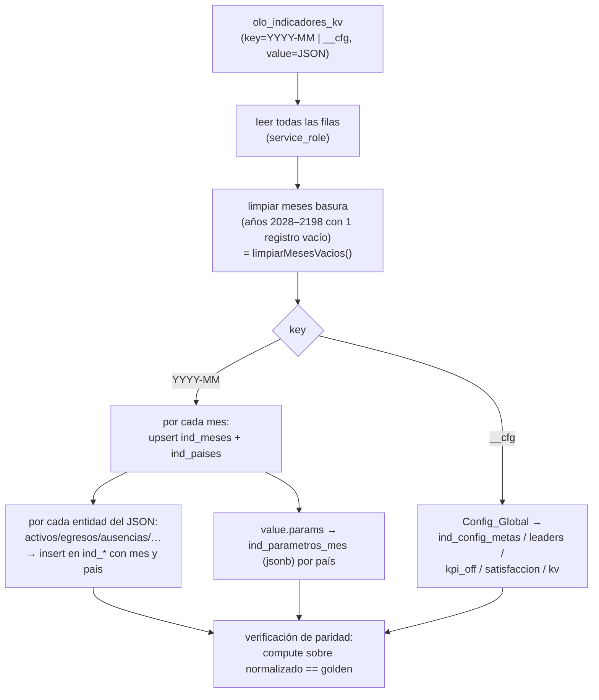

# Design Document

## Overview

Este documento describe el diseño técnico para migrar el sistema monolítico "Indicadores de Personal · OLO" (`out/index.html`, ~2440 líneas de HTML/CSS/JS inline) a una aplicación Next.js (App Router) + React + TypeScript con backend Supabase (base de datos normalizada, Supabase Auth, RLS por país).

El principio rector es que `out/index.html` es la **fuente de verdad** del comportamiento y la apariencia. El diseño está organizado alrededor de dos requisitos duros y transversales:

- **Paridad numérica**: para los mismos datos de entrada, cada KPI debe producir el mismo valor que el sistema actual, con tolerancia 1e-6 para `pct`/`days`/`num` y exactitud para `int` (Requirements 1.4, 18.1–18.4).
- **Paridad visual pixel-por-pixel**: colores, tipografías (Inter / Space Grotesk), layout y componentes idénticos (Requirements 16.1–16.4).

La estrategia central para lograr paridad numérica es **extraer el motor de cálculo como módulos TypeScript puros** (sin DOM, sin globales, sin `localStorage`), portando función por función las ~60 funciones del `index.html` actual, y validarlo con **tests de paridad numérica contra fixtures de datos reales** exportados del sistema actual.

El cambio de arquitectura de datos (de kv a normalizado) se aísla detrás de una **capa de ensamblaje** (`assembleMesData`) que reconstruye, a partir de las tablas normalizadas, exactamente el objeto `MesData` que el motor espera. De este modo, el motor portado no "sabe" que la base de datos cambió: recibe la misma forma de datos que consumía el `compute(k)` original.

### Decisiones de arquitectura (fijadas, no se re-evalúan)

| Decisión | Elección |
|---|---|
| Framework | Next.js App Router + React + TypeScript (no Vite) |
| Backend | Supabase: Postgres normalizado, Supabase Auth real, RLS por país en servidor |
| Ubicación | Carpeta nueva `indicadores-app`, hermana del proyecto actual; `out/index.html` intacto |
| Paridad | Visual pixel-por-pixel y numérica = requisitos duros |

### Mapa de trazabilidad (requirement → sección de diseño)

| Requirement | Sección |
|---|---|
| 1, 2, 3, 4, 18 (motor, semáforos, modos, derivados, paridad numérica) | Portabilidad del Motor · Correctness Properties |
| 5, 7, 8 (dashboard, corporativa, comparativa) | Componentes e Interfaces · Paridad Visual |
| 6, 9, 10 (administrar, import, export) | Import/Export · Capa de Acceso a Datos |
| 11 (modelo normalizado) | Data Models · Esquema de Base de Datos |
| 12, 13, 14 (auth, RLS, usuarios) | Autenticación y RLS |
| 15 (migración) | Migración de Datos |
| 16 (paridad visual) | Paridad Visual |
| 17 (rendimiento) | Testing Strategy · Error Handling |

## Architecture

### Arquitectura de alto nivel



El motor de indicadores vive en el cliente (igual que hoy, para recalcular al instante al cambiar filtros — Requirement 17.1) pero es un módulo aislado y testeable. El servidor (Server Components) hace el fetch inicial de datos del mes/país aplicando RLS, y la capa `assembleMesData` reconstruye el `MesData` que el motor consume.

### Flujo de datos: de tablas normalizadas a KPI



### Organización de carpetas

```
indicadores-app/
├── app/                          # App Router
│   ├── layout.tsx                # fuentes (next/font), CSS global, providers
│   ├── globals.css               # :root variables + estilos portados 1:1
│   ├── (auth)/
│   │   └── login/page.tsx        # pantalla de login (Supabase Auth)
│   ├── (app)/                    # grupo protegido por sesión
│   │   ├── layout.tsx            # Header + FilterBar + PillNav + guard de sesión
│   │   ├── dashboard/page.tsx    # Dashboard_Operativo (vista por defecto)
│   │   ├── administrar/page.tsx  # Pantalla_Administrar
│   │   ├── corporativa/page.tsx  # Vista_Corporativa
│   │   ├── comparativa/page.tsx  # Vista_Comparativa
│   │   └── usuarios/page.tsx     # Pantalla_Usuarios
│   ├── api/                      # route handlers si se requieren (export server-side, admin)
│   └── middleware.ts             # refresco de sesión + redirección a /login
│
├── core/                         # ⭐ Motor de indicadores — TypeScript PURO, sin DOM
│   ├── kpi-defs.ts               # KPI[], KMAP, ACC_RATIO, ACC_SUM, SRC, NIV, meses
│   ├── dates.ts                  # yearsBetween, asofFor, bizDaysInMonth, nthBizDay, …
│   ├── compute.ts                # compute(k, db, ctx) → ComputeResult
│   ├── accumulate.ts             # accValue, valOf (modos acumulado/mensual)
│   ├── desercion.ts              # desercion12, lastAccidentInfo
│   ├── semaphore.ts              # sem, eslBand, kpiValid, meta
│   ├── format.ts                 # pct, fmt, nfmt (formato es-CR)
│   └── types.ts                  # tipos del dominio (Colaborador, MesData, …)
│
├── components/
│   ├── Header.tsx  FilterBar.tsx  PillNav.tsx
│   ├── KpiCard.tsx  Semaforo.tsx  Sparkline.tsx  EslBadge.tsx
│   ├── tables/ (DistTable, BarRow, MatrizCorporativa, …)
│   └── admin/ (CargaWizard, MasterUpload, ParamGrid, EditableTable)
│
├── lib/
│   ├── supabase/
│   │   ├── client.ts             # createBrowserClient (anon)
│   │   ├── server.ts             # createServerClient (cookies, SSR)
│   │   └── admin.ts              # createClient(service_role) — solo server, admin/migración
│   ├── data/
│   │   ├── assemble.ts           # assembleMesData / assembleDB (normalizado → MesData)
│   │   ├── queries.ts            # loadMes, loadYear, loadConfig (fetch por mes/país)
│   │   └── writes.ts             # upsert por país (equivalente a ingestReplace)
│   ├── io/
│   │   ├── import/ (field-alias.ts, normval.ts, parse-rows.ts, ingest.ts, colmap.ts)
│   │   └── export/ (xlsx.ts, pdf.ts, master-template.ts) — dynamic import
│   └── auth/ (session.ts, rbac.ts)
│
├── supabase/
│   ├── migrations/               # DDL normalizado + RLS + perfiles
│   │   ├── 010_schema.sql
│   │   ├── 011_rls.sql
│   │   └── 012_profiles_auth.sql
│   ├── types.ts                  # tipos generados (supabase gen types)
│   └── migrate/                  # scripts de migración kv → normalizado
│       ├── migrate-data.ts
│       └── migrate-users.ts
│
├── test/
│   ├── fixtures/                 # snapshots reales exportados del sistema actual
│   │   ├── db.snapshot.json      # export de olo_indicadores_kv
│   │   └── expected-kpis.json    # KPIs calculados por el sistema actual (golden)
│   ├── parity/                   # tests de paridad numérica
│   └── property/                 # property-based tests del motor
│
├── .env.local.example
├── next.config.ts  tsconfig.json  package.json
```

## Components and Interfaces

### 1. Motor de indicadores (`core/`)

El motor es la pieza más crítica. La estrategia de portabilidad se detalla en la sección "Portabilidad del Motor de Indicadores". La interfaz pública:

```typescript
// core/compute.ts
export interface ComputeContext {
  pais: string;          // "__all__" | "Costa Rica" | "Venezuela"  (reemplaza el global PAIS)
  dep: string;           // "__all__" | nombre de departamento      (reemplaza DEP)
  area: string;          // "__all__" | nombre de área              (reemplaza AREA)
  today: Date;           // reemplaza el global TODAY (inyectable para tests deterministas)
  dashYear: number;      // año del dashboard (reconocimientos)     (reemplaza +CUR.slice(0,4))
}

export function compute(k: MonthKey, db: ConfigDB, ctx: ComputeContext): ComputeResult;
// ind: valores finales por KPI; raw: pares [num, den] para acumulados; + distribuciones
```

Todos los estados globales del `index.html` (`DB`, `PAIS`, `DEP`, `AREA`, `CUR`, `VIEW`, `TODAY`) se convierten en **parámetros explícitos**. Esto es lo que hace al motor puro y testeable.

### 2. Componentes de presentación (`components/`)

Cada componente del sistema actual se porta a un componente React con markup y clases CSS equivalentes (ver "Paridad Visual"):

| Componente React | Equivalente en `index.html` | Rol |
|---|---|---|
| `Header` | `header.app` / `.app-inner` / `.logo` / `.hactions` | logo, acciones, chip de usuario |
| `FilterBar` | `.filters` / `.filters-inner` / `.fgroup` | selectores período/país/área/dep |
| `PillNav` | `.pillnav` / `.pill` / `.dseg` | navegación de 5 vistas + segmento de densidad |
| `KpiCard` | `.kpi` (builder `kpiSecHTML`) | tarjeta de KPI con valor, delta, target, def |
| `Semaforo` | `.sem` / `.dot` + función `sem()` | punto de color ok/warn/danger/na |
| `Sparkline` | `.kpi .spark .b` | serie temporal del KPI |
| `EslBadge` | `.esl-badge` / `.esl-dot` + `eslBand()` | banda de satisfacción (escala 0–5) |
| `DistTable` / `BarRow` | `.card` / `table` / `.bar-row` | distribuciones (sexo, nivel, área…) |
| `MatrizCorporativa` | builders de Vista Corporativa | matriz anual + modo presentación |
| `CargaWizard` / `ParamGrid` | `renderAdmin` / `.param-grid` / `.lvlrow` | asistente de carga y edición de parámetros |

### 3. Capa de datos (`lib/data/`)

```typescript
// lib/data/queries.ts  (ejecutado en Server Components)
export async function loadMes(mes: MonthKey, pais: PaisScope): Promise<MesData>;
export async function loadDB(year: number, pais: PaisScope): Promise<ConfigDB>; // año completo + __cfg
export async function loadConfig(): Promise<ConfigGlobal>;

// lib/data/assemble.ts
export function assembleMesData(rows: NormalizedRows): MesData;   // filas tabulares → forma MesData
export function assembleDB(rowsByMonth, cfg): ConfigDB;           // ensambla el "DB" completo

// lib/data/writes.ts  (equivalente a ingestReplace: reemplazo por país)
export async function replaceByPais(kind: EntityKind, mes: MonthKey, pais: string, rows: unknown[]): Promise<number>;
```

### 4. Autenticación (`lib/auth/`, `lib/supabase/`)

```typescript
// lib/auth/session.ts
export async function getSession(): Promise<{ user: User; profile: Perfil } | null>;
export async function requireAuth(): Promise<SessionCtx>;      // redirige a /login si no hay sesión

// lib/auth/rbac.ts
export type Scope = "global" | "pais" | "admin";
export function resolvePaisScope(profile: Perfil): PaisScope;  // "__all__" | pais fijo
export function canManageUsers(scope: Scope): boolean;         // admin | global
export function canSeeData(scope: Scope): boolean;             // global | pais (admin = false)
```

## Data Models

### Tipos del dominio (TypeScript)

Estos tipos reflejan la forma de datos que el motor consume hoy en `index.html`. Son la frontera entre la capa de datos y el motor.

```typescript
// core/types.ts
export type MonthKey = `${number}-${number}`;      // "YYYY-MM"
export type Pais = "Costa Rica" | "Venezuela" | string;
export type PaisScope = "__all__" | Pais;
export type Sexo = "Masculino" | "Femenino" | "Otro" | "";
export type Movilidad = "M1"|"M2"|"M3"|"M4"|"M5"|"M6"|"M7 NN"|string;
export type NivelEducativo = "Primaria"|"Secundaria"|"Técnico"|"Universitario"|"Posgrado"|"";
export type Movimiento = "Promoción"|"Ascenso"|"Sin cambio"|string;
export type TipoContrato = "Indeterminado"|"Determinado";
export type MotivoEgreso = "Renuncia"|"Despido"|"Finalización"|"Jubilación"|"Mutuo acuerdo"|string;

export interface Colaborador {        // "activos"
  id: string;                         // CÉDULA — clave natural por persona (Req 11.2)
  pais: Pais;
  nombre: string;
  departamento: string;
  area: string;
  sexo: Sexo;
  fecha_nacimiento: string;           // ISO YYYY-MM-DD
  fecha_ingreso: string;              // ISO
  nivel: string;                      // N1..N5
  nivel_educativo: NivelEducativo;
  carrera: string;
  movilidad: Movilidad;
  movimiento: Movimiento;
  tipo: TipoContrato;
  paso: string;                       // "1".."5"
  vac_disfrutadas: number;
  vac_pendientes: number;
}

export interface Egreso {
  id: string; pais: Pais; nombre: string; departamento: string;
  motivo: MotivoEgreso;
  fecha_ingreso: string; fecha_salida: string;
  movilidad: Movilidad; recomienda: "Sí"|"No"|"";
}
export interface Ausencia { id: string; pais: Pais; nombre: string; departamento: string; tipo: string; dias: number; }
export interface Vacacion { id: string; pais: Pais; nombre: string; departamento: string; area: string; dias: number; }
export interface Extra    { id: string; pais: Pais; nombre: string; departamento: string; area: string; horas: number; }
export interface Capacitacion { pais: Pais; area_conocimiento: string; curso: string; horas: number; participantes: number; }
export interface Merma    { pais: Pais; area: string; cantidad: number; }
export interface Tercero  { pais: Pais; cantidad: number; }
export interface Area     { grupo: string; area: string; colaboradores: number; }

export interface ParametrosMes {      // ~40 parámetros numéricos por mes/país
  hc_indet: number[]; hc_det: number[]; suc_p45: number[];        // arrays de 5 (por nivel)
  vac_dias: number; vac_cant: number; vac_fecha: string;
  of_realizadas: number; of_rechazadas: number; of_descartados: number; of_contactados: number;
  rot_ini: number; rot_egr: number; des_egr12: number; des_ing12: number;
  dias_habiles: number; nuevos: number; prom_colab: number; colab_vac: number;
  mant_cierre: number; accidentes: number; capacitados: number; incidentes: number;
  colab_accid: number; mant_plan: number; ot_dias: number; mant_prev: number; record_dias: number;
  encuesta: number; fecha_ult_accidente: string; accid_area: string;
  ruta_basicas: number; ruta_tecnicas: number; ruta_liderazgo: number; merma_hurto: number;
  horas_hombre?: number; hh_ord?: number; hh_ext?: number;
}

export interface MesData {            // lo que compute() consume para un mes
  activos: Colaborador[]; egresos: Egreso[]; ausencias: Ausencia[];
  vacaciones: Vacacion[]; extras: Extra[]; capacitacion: Capacitacion[];
  merma: Merma[]; terceros: Tercero[]; areas: Area[];
  params: ParametrosMes;
}

export interface ConfigGlobal {       // "__cfg"
  metas: Record<string, [number, number] | null>;    // umbrales por KPI (override de t[])
  leaders: { area: string; lider: string; correo: string }[];
  sysUrl: string;
  kpiOff: string[];                                   // KPIs desactivados
  satisfaccion: Record<string, number>;               // por año: { "2025": 4.1 }
}

export interface ConfigDB {           // el "DB" completo: meses + config
  __cfg: ConfigGlobal;
  [mes: MonthKey]: MesData;
}

export type KpiType = "pct" | "int" | "days" | "num";
export interface KPI {
  k: string; name: string; unit: string; type: KpiType;
  lower?: boolean; info?: boolean; esl?: boolean;
  t?: [number, number]; def: string;
}
export interface Grupo { g: string; area: string; sub: string; items: KPI[]; }

export interface Rol { id: string; nombre: string; scope: Scope; pais: string | null; }
export interface Perfil { user_id: string; email: string; nombre: string; rol_id: string; rol?: Rol; activo: boolean; }

export interface ComputeResult {
  ind: Record<string, number | null>;        // valor final por KPI
  raw: Record<string, [number, number]>;      // [numerador, denominador] para acumulados
  // distribuciones y agregados para las vistas (hcN, sexoC, educC, egByDep, …)
  hcTot: number; prom: number; edadProm: number; antigProm: number; diasSinAcc: number | null;
  [extra: string]: unknown;
}
```

### Esquema de Base de Datos Normalizado (SQL/DDL)

Reemplaza el esquema key/value `olo_indicadores_kv` (una fila por `YYYY-MM` con un JSON gigante) por tablas relacionales. Las tablas nuevas usan el prefijo `ind_` para no colisionar con las tablas kv de la suite OLO que permanecen intactas.

#### Decisión de modelado: snapshot mensual (no maestro + histórico)

El sistema actual trata cada mes como un **snapshot independiente**: el mismo colaborador (misma cédula) aparece en varios meses, y sus atributos (área, nivel, movimiento, vacaciones) pueden cambiar mes a mes. El motor `compute(k)` nunca arrastra el roster de otros meses (comentario explícito en el código: *"No se arrastra el roster de otros meses"*). Para preservar **paridad numérica exacta**, el esquema replica esa semántica: la tabla `ind_colaboradores` guarda **una fila por (cédula, mes, país)** — un snapshot mensual. La cédula es la clave natural *de la persona* (Req 11.2), pero la clave primaria de la fila es compuesta porque el mismo colaborador tiene un registro por mes.

Esto evita reconstruir estado histórico y garantiza que `assembleMesData("2026-07")` devuelva exactamente las filas que el snapshot de julio tenía.

```mermaid
erDiagram
  ind_paises ||--o{ ind_colaboradores : "pais"
  ind_paises ||--o{ ind_egresos : "pais"
  ind_meses  ||--o{ ind_colaboradores : "mes"
  ind_meses  ||--o{ ind_egresos : "mes"
  ind_meses  ||--o{ ind_parametros_mes : "mes"
  auth_users ||--|| ind_perfiles : "user_id"
  ind_roles  ||--o{ ind_perfiles : "rol_id"

  ind_paises { text nombre PK }
  ind_meses { text mes PK }
  ind_colaboradores {
    text cedula
    text mes
    text pais
    text nombre
    text departamento
    text area
    text sexo
    date fecha_nacimiento
    date fecha_ingreso
    text nivel
    text nivel_educativo
    text carrera
    text movilidad
    text movimiento
    text tipo
    text paso
    numeric vac_disfrutadas
    numeric vac_pendientes
  }
  ind_egresos {
    bigint id PK
    text cedula
    text mes
    text pais
    text motivo
    date fecha_ingreso
    date fecha_salida
    text movilidad
    text recomienda
  }
  ind_parametros_mes {
    text mes
    text pais
    jsonb params
  }
  ind_perfiles {
    uuid user_id PK
    text rol_id
    text pais
  }
  ind_roles { text id PK, text scope, text pais }
```

#### DDL

```sql
-- ============ Catálogos ============
create table public.ind_paises (
  nombre text primary key                       -- 'Costa Rica', 'Venezuela'
);

create table public.ind_meses (
  mes text primary key check (mes ~ '^\d{4}-\d{2}$')   -- 'YYYY-MM'
);

-- ============ Snapshot mensual de colaboradores ============
create table public.ind_colaboradores (
  cedula           text not null,               -- clave natural de la persona (Req 11.2)
  mes              text not null references public.ind_meses(mes) on delete cascade,
  pais             text not null references public.ind_paises(nombre),
  nombre           text,
  departamento     text,
  area             text,
  sexo             text,
  fecha_nacimiento date,
  fecha_ingreso    date,
  nivel            text,                         -- N1..N5
  nivel_educativo  text,
  carrera          text,
  movilidad        text,                         -- M1..M7 NN
  movimiento       text,                         -- Promoción / Ascenso / Sin cambio
  tipo             text,                         -- Indeterminado / Determinado
  paso             text,
  vac_disfrutadas  numeric default 0,
  vac_pendientes   numeric default 0,
  primary key (cedula, mes, pais)                -- un snapshot por persona/mes/país
);
create index ind_colab_mes_pais on public.ind_colaboradores (mes, pais);
create index ind_colab_dep       on public.ind_colaboradores (mes, pais, departamento);

-- ============ Egresos ============
create table public.ind_egresos (
  id            bigint generated always as identity primary key,
  cedula        text,
  mes           text not null references public.ind_meses(mes) on delete cascade,
  pais          text not null references public.ind_paises(nombre),
  nombre        text,
  departamento  text,
  motivo        text,                            -- Renuncia / Despido / Finalización / …
  fecha_ingreso date,
  fecha_salida  date,
  movilidad     text,
  recomienda    text                             -- Sí / No / ''
);
create index ind_egresos_mes_pais on public.ind_egresos (mes, pais);
-- Nota: desercion12 cruza egresos de TODOS los meses en una ventana de 12 meses;
-- por eso egresos se consulta por rango de 'mes', no solo por el mes actual.

-- ============ Ausencias / Vacaciones / Extras / Capacitación / Merma / Terceros ============
create table public.ind_ausencias (
  id bigint generated always as identity primary key,
  cedula text, mes text not null references public.ind_meses(mes) on delete cascade,
  pais text not null references public.ind_paises(nombre),
  nombre text, departamento text, tipo text, dias numeric default 0
);
create table public.ind_vacaciones (
  id bigint generated always as identity primary key,
  cedula text, mes text not null references public.ind_meses(mes) on delete cascade,
  pais text not null references public.ind_paises(nombre),
  nombre text, departamento text, area text, dias numeric default 0
);
create table public.ind_extras (
  id bigint generated always as identity primary key,
  cedula text, mes text not null references public.ind_meses(mes) on delete cascade,
  pais text not null references public.ind_paises(nombre),
  nombre text, departamento text, area text, horas numeric default 0
);
create table public.ind_capacitacion (
  id bigint generated always as identity primary key,
  mes text not null references public.ind_meses(mes) on delete cascade,
  pais text not null references public.ind_paises(nombre),
  area_conocimiento text, curso text, horas numeric default 0, participantes numeric default 0
);
create table public.ind_merma (
  id bigint generated always as identity primary key,
  mes text not null references public.ind_meses(mes) on delete cascade,
  pais text not null references public.ind_paises(nombre),
  area text, cantidad numeric default 0
);
create table public.ind_terceros (
  id bigint generated always as identity primary key,
  mes text not null references public.ind_meses(mes) on delete cascade,
  pais text not null references public.ind_paises(nombre),
  cantidad numeric default 0
);
-- areas NO lleva país en el sistema actual (COLMAP.areas = [grupo, area, colaboradores])
create table public.ind_areas (
  id bigint generated always as identity primary key,
  mes text not null references public.ind_meses(mes) on delete cascade,
  grupo text, area text, colaboradores numeric default 0
);

-- ============ Parámetros por mes/país ============
-- Los ~40 params incluyen arrays (hc_indet[5], hc_det[5], suc_p45[5]) y escalares
-- heterogéneos. Se guardan como JSONB tipado para no crear 40 columnas y preservar
-- exactamente la forma que compute() espera. La capa de ensamblaje valida el shape.
create table public.ind_parametros_mes (
  mes    text not null references public.ind_meses(mes) on delete cascade,
  pais   text not null references public.ind_paises(nombre),
  params jsonb not null default '{}'::jsonb,
  primary key (mes, pais)
);

-- ============ Config global ============
create table public.ind_config_metas    ( kpi text primary key, a numeric, b numeric );
create table public.ind_config_leaders   ( area text primary key, lider text, correo text );
create table public.ind_config_kpi_off   ( kpi text primary key );
create table public.ind_config_satisfaccion ( anio int primary key, valor numeric );
create table public.ind_config_kv         ( key text primary key, value text );  -- sysUrl, etc.

-- ============ Roles y perfiles (Supabase Auth) ============
create table public.ind_roles (
  id     text primary key,                       -- 'global','admin','costa_rica','venezuela'
  nombre text not null,
  scope  text not null default 'pais' check (scope in ('global','pais','admin')),
  pais   text references public.ind_paises(nombre),
  created_at timestamptz not null default now()
);
create table public.ind_perfiles (
  user_id uuid primary key references auth.users(id) on delete cascade,
  email   text,
  nombre  text,
  rol_id  text not null references public.ind_roles(id),
  activo  boolean not null default true,
  created_at timestamptz not null default now()
);
```

#### Decisión: `params` como JSONB tipado

Los ~40 parámetros son heterogéneos: arrays de 5 (niveles), escalares, fechas y strings. Crear 40+ columnas sería frágil y no aporta valor de consulta (nunca se filtra por un parámetro individual; siempre se cargan todos juntos para `compute`). Se guarda `params` como JSONB con un tipo TypeScript (`ParametrosMes`) que la capa de ensamblaje valida al leer, garantizando la forma exacta que `compute()` espera. Esto mantiene la fidelidad numérica sin sobre-normalizar datos que siempre se leen en bloque.

## Portabilidad del Motor de Indicadores

Esta es la sección más crítica para la paridad numérica (Requirements 1, 2, 3, 4, 18).

### Principio: port literal primero, refactor después (si acaso)

Las ~60 funciones puras del `index.html` se portan **línea por línea** a TypeScript, preservando la aritmética exacta (incluidos los detalles de `Date`, `365.25*864e5`, `safe(n,d)=d>0?n/d:0`, redondeos). No se "mejora" ni se "limpia" la lógica en la primera pasada: cualquier cambio arriesga la paridad numérica. Los tests de paridad (abajo) son el contrato.

### Funciones a portar (referenciadas por nombre del sistema actual)

| Módulo destino | Funciones del `index.html` |
|---|---|
| `core/dates.ts` | `asofFor`, `yearsBetween`, `bizDaysInMonth`, `isBiz`, `nthBizDay`, `lastDay`, `addBiz`, `bizBetween`, `fmtDate` |
| `core/desercion.ts` | `desercion12`, `lastAccidentDate`, `lastAccidentInfo` |
| `core/compute.ts` | `compute`, `rosterInfo`, helpers `sum`, `safe`, `nivIdx`, `hasData`, `M` (como lectura pura), `meta`, `kpiOn` |
| `core/accumulate.ts` | `accValue`, `valOf` |
| `core/kpi-defs.ts` | `KPI[]`, `KMAP`, `ACC_RATIO`, `ACC_SUM`, `SRC`, `NIV`, `MSHORT`, `MLONG`, `MONTHS`/`monthsOf`, `mi`, `yOf` |
| `core/semaphore.ts` | `sem`, `eslBand`, `kpiValid` |
| `core/format.ts` | `pct`, `fmt`, `nfmt` |

### Eliminación de dependencias globales

Cada global del motor se convierte en parámetro o en campo de `ComputeContext`:

| Global en `index.html` | En el motor portado |
|---|---|
| `DB` | parámetro `db: ConfigDB` |
| `PAIS` | `ctx.pais` (filtro `fp = r => ctx.pais==="__all__" || r.pais===ctx.pais`) |
| `DEP`, `AREA` | `ctx.dep`, `ctx.area` |
| `CUR` | argumento `k: MonthKey` (y `ctx.dashYear` para reconocimientos) |
| `VIEW` | argumento explícito en `valOf(it, k, db, ctx, view)` |
| `TODAY` / `ASOF` | `ctx.today` (inyectable → tests deterministas) |
| `localStorage` / `save()`/`load()` | eliminados del motor; viven en la capa de datos |
| `CFG()` lazy-init | `db.__cfg` ya normalizado por la capa de datos |

**Nota sobre `ctx.today`**: `asofFor` y `desercion12` usan `TODAY`. Para que los fixtures sean reproducibles, los tests fijan `ctx.today` a la misma fecha con la que se generó el golden. En producción es `new Date()`.

### Preservación de detalles sutiles (riesgos de paridad)

El port debe conservar exactamente estos comportamientos observados en el código actual:

1. **`safe(n,d) = d>0 ? n/d : 0`** — denominador cero devuelve 0 (Req 1.5). No lanzar, no `NaN`.
2. **Antigüedad/edad en años** = `(asof - fecha) / (365.25 * 864e5)`; se descartan edades fuera de `(0,90)` y antigüedades fuera de `[0,60)`.
3. **`desercion12`**: ventana `start = new Date(y, mo-12, 1)`, `end = new Date(y, mo, 0)`; egresos con `0 <= t < 1` años; **el conteo de ingresos suma activos del mes k Y egresos con ingreso en la ventana** (comportamiento literal del código, aunque parezca doble conteo — se replica tal cual).
4. **Precedencia manual vs. lista** (Req 1.6): `nuevos = p.nuevos>0 ? p.nuevos : nuevosDer`; `rot_ini = rosterN ? rotIniDer : p.rot_ini`; `des_ing = p.des_ing12>0 ? p.des_ing12 : der12.ing`; etc. Replicar cada ternario.
5. **`movimStatus`**: si `movimiento` viene como estado histórico (hay "Sin cambio" o el campo está lleno para todo el roster), `promo/ascenso/promo_asc` devuelven `null` (no 0). El `null` es significativo: la UI lo muestra como no disponible.
6. **`mant_prev`**: `(v>1 ? v/100 : v)` — normaliza porcentaje.
7. **`encuesta`**: `p.encuesta || cfg.satisfaccion[año] || 0` (Req 4.7).
8. **`merma_hurto`**: `mermaTot>0 ? mermaTot : p.merma_hurto`.
9. **`diasSinAcc`**: `lastAcc ? max(0, round((asof-lastAcc)/864e5)) : null`.
10. **Roster sin arrastre**: si el mes no tiene `activos`, headcount/niveles salen de `params` (no se inventan colaboradores de otros meses).
11. **`accValue`**: acumulado solo sobre meses con `hasData`, desde enero (`MONTHS.slice(0, mi(k)+1)`); ACC_RATIO suma `[num,den]` por separado y luego `safe`; ACC_SUM suma solo numeradores; el resto es snapshot.
12. **`sem`**: `lower ? (v<=a?ok:v<=b?warn:danger) : (v>=b?ok:v>=a?warn:danger)`; `meta(it)` usa override de `cfg.metas` si existe y es válido, si no `it.t`.
13. **`eslBand`**: cortes exactos 3.88 / 4.02 / 4.29 / 4.43 con sus colores.

### Estrategia de tests de paridad numérica



**Generación del golden (una vez):**
1. Exportar la base real desde Supabase: `select key, value from olo_indicadores_kv` → `test/fixtures/db.snapshot.json`.
2. Añadir temporalmente al `index.html` una función que, para cada mes con datos y cada país (`__all__`, `Costa Rica`, `Venezuela`), vuelque `compute(k).ind`, `compute(k).raw` y `accValue(itk,k)` para los 29 KPIs, con `TODAY` fijado a una fecha constante → `test/fixtures/expected-kpis.json`.

**Test de paridad (CI):** por cada (mes, país, KPI, modo mensual/acumulado), comparar el valor del motor portado contra el golden:
- `int` → igualdad exacta (Req 18.3).
- `pct` / `days` / `num` → `|a - b| <= 1e-6` (Req 18.2).
- valores derivados (edad, antigüedad, deserción, días sin accidente, horas hombre) → tolerancia 1e-6 (Req 18.4).
- `null` → el otro también `null` (casos `movimStatus` y KPIs no disponibles).

Este set de tests es el **criterio de aceptación objetivo** de la migración del motor: mientras pase, la paridad numérica está garantizada sobre los datos reales.

## Capa de Acceso a Datos

### Lectura: Server Components + Supabase server client

Las páginas son Server Components que hacen el fetch inicial con el **server client** (lee la cookie de sesión y aplica RLS en el servidor — Req 13.1/13.4). El resultado se pasa como prop serializable al árbol cliente, que monta el motor para recalcular al vuelo sin round-trips.

```typescript
// app/(app)/dashboard/page.tsx  (Server Component)
export default async function DashboardPage({ searchParams }) {
  const { profile } = await requireAuth();
  const paisScope = resolvePaisScope(profile);         // pais fijo o __all__
  const mes = (searchParams.mes ?? defaultMes) as MonthKey;
  const year = +mes.slice(0,4);
  const db = await loadDB(year, paisScope);            // año completo (sparklines/acumulado) + __cfg
  return <DashboardClient db={db} mes={mes} paisScope={paisScope} profile={profile} />;
}
```

### Ensamblaje: de filas normalizadas a `MesData`

`loadDB` trae las filas por rango de mes (el dashboard necesita todo el año para sparklines y acumulados; `desercion12` necesita hasta 12 meses hacia atrás → `loadDB` carga también los meses previos requeridos). `assembleDB` agrupa por `mes` y arma el `ConfigDB` con la misma forma que el `DB` original:

```typescript
// lib/data/assemble.ts
export function assembleMesData(r: {
  activos: ColaboradorRow[]; egresos: EgresoRow[]; /* … */ parametros?: { params: ParametrosMes };
}): MesData {
  return {
    activos: r.activos.map(toColaborador),
    egresos: r.egresos.map(toEgreso),
    // … resto de entidades …
    params: normalizeParams(r.parametros?.params),   // garantiza arrays de 5, defaults, shape exacto
  };
}
```

La estrategia de fetch por mes/país:
- **Dashboard** (un mes, un país o consolidado): `loadDB(year, pais)` + meses previos para `desercion12`.
- **Corporativa / Comparativa por año**: `loadDB(year, pais)` (los 12 meses).
- **Comparativa por país**: `loadDB(year, "__all__")` y el motor filtra con `ctx.pais` en memoria para cada país.

### Escritura: reemplazo por país (equivalente a `ingestReplace`)

`replaceByPais` replica la semántica de `ingestReplace` + `cargaPais` del sistema actual (Req 6.5): al cargar datos de un mes para un país, se borran solo las filas de ese país en ese mes y se insertan las nuevas; las filas de otros países quedan intactas. Un usuario `scope='pais'` siempre fuerza su propio país (no puede inyectar otro), y RLS lo refuerza en el servidor.

```typescript
export async function replaceByPais(kind, mes, pais, rows) {
  const sb = createServerClient();
  await sb.from(TABLE[kind]).delete().match({ mes, pais });   // RLS garantiza país
  const { count } = await sb.from(TABLE[kind]).insert(rows.map(r => ({ ...r, mes, pais })));
  return count;
}
```

## Autenticación y RLS

### Supabase Auth (email/password) reemplaza el login PBKDF2

El sistema actual autentica contra una tabla propia (`olo_indicadores_usuarios`) con hash PBKDF2 derivado en el navegador. El nuevo sistema usa **Supabase Auth** (`auth.users`) con email/password (Req 12.1). Una tabla `ind_perfiles` vincula `auth.users.id` con `rol_id`, y el rol define `scope` y `pais`.



### Resolución del país del usuario en las policies

Las policies necesitan conocer el país del usuario sin un JOIN costoso por fila. Dos opciones; se elige la **función `security definer`** por simplicidad y porque centraliza la lógica:

```sql
-- Resuelve el scope y país del usuario autenticado a partir de su perfil + rol.
create or replace function public.ind_user_scope()
returns table (scope text, pais text)
language sql stable security definer set search_path = public as $$
  select r.scope, r.pais
  from public.ind_perfiles p
  join public.ind_roles r on r.id = p.rol_id
  where p.user_id = auth.uid() and p.activo
$$;
```

### Policies RLS por tabla

Patrón para toda tabla de datos con columna `pais` (colaboradores, egresos, ausencias, vacaciones, extras, capacitación, merma, terceros, parámetros):

```sql
alter table public.ind_colaboradores enable row level security;

-- SELECT: global ve todo; pais ve solo su país; admin no ve data.
create policy ind_colab_select on public.ind_colaboradores for select to authenticated
using (
  exists (
    select 1 from public.ind_user_scope() s
    where s.scope = 'global'
       or (s.scope = 'pais' and s.pais = ind_colaboradores.pais)
  )
);

-- INSERT/UPDATE/DELETE: global escribe cualquier país; pais solo el suyo; admin nada.
create policy ind_colab_write on public.ind_colaboradores for all to authenticated
using (
  exists (select 1 from public.ind_user_scope() s
          where s.scope='global' or (s.scope='pais' and s.pais = ind_colaboradores.pais))
)
with check (
  exists (select 1 from public.ind_user_scope() s
          where s.scope='global' or (s.scope='pais' and s.pais = ind_colaboradores.pais))
);
```

- **`scope='pais'`** (Req 13.1, 13.4): solo filas donde `pais = s.pais`, aplicado en el servidor → el navegador nunca recibe filas de otro país.
- **`scope='global'`** (Req 13.2): acceso a todos los países; la UI habilita el selector.
- **`scope='admin'`** (Req 13.3): no aparece en ningún `using` de las tablas de datos → no ve indicadores; sí gestiona `ind_perfiles`/`ind_roles`.

Policy para gestión de usuarios (Req 14):

```sql
-- Solo admin o global pueden gestionar perfiles/roles.
create policy ind_perfiles_admin on public.ind_perfiles for all to authenticated
using (exists (select 1 from public.ind_user_scope() s where s.scope in ('admin','global')))
with check (exists (select 1 from public.ind_user_scope() s where s.scope in ('admin','global')));
```

`ind_areas` no tiene país (igual que el sistema actual); su policy permite lectura a `global`/`pais` y escritura a `global` (o a quien cargue, según se decida en Tasks).

## Import / Export

### Estrategia de carga diferida (dynamic import)

Las librerías pesadas (SheetJS ~900 KB, jsPDF + autotable) se cargan solo cuando se usan, mediante `dynamic import` en componentes cliente, para no inflar el bundle inicial (Req 17.3):

```typescript
async function exportXlsx(data) {
  const XLSX = await import("xlsx");            // se descarga al primer uso
  // … misma lógica que exportOperativaMes/Anio …
}
async function exportPdf(node) {
  const { jsPDF } = await import("jspdf");
  await import("jspdf-autotable");
  // … misma lógica que downloadPDF / downloadPDFOperativa …
}
```

### Importador (`lib/io/import/`)

Se portan **tal cual** las piezas del sistema actual:

| Módulo | Del `index.html` | Función |
|---|---|---|
| `field-alias.ts` | `FIELD_ALIAS` | alias de encabezados por campo (Req 9.2) |
| `colmap.ts` | `COLMAP` | columnas por tipo de hoja |
| `normval.ts` | `normVal`, `eduCarrera`, `titleCase`, `toISODate`, `NA` | normalización de fecha/sexo/país/movilidad/nivel educativo (Req 9.3) |
| `parse-rows.ts` | `parseRows`, `headRow`, `resolveIdx`, `idxAnio`, `idxMes`, `monthKeyFrom` | mapeo de matriz a objetos, soporte AÑO/MES (Req 9.5) |
| `ingest.ts` | `ingestReplace`, `cargaPais`, `applySatisfaccion` | reemplazo por país (Req 6.5), satisfacción anual |
| `master.ts` | lectura de hojas de `masterTemplate` | Plantilla_Maestra multi-hoja (Req 9.4) |

El import ya no escribe en `localStorage`/`DB`; produce objetos normalizados que `replaceByPais` persiste en las tablas (reemplazo por país). Si falta una columna requerida, se reporta el campo faltante (Req 9.6), preservando los mensajes actuales.

### Exportador (`lib/io/export/`)

Se portan `exportOperativaMes`, `exportOperativaAnio` (Excel por mes/año, Req 10.1/10.2), `downloadPDFOperativa` y `downloadPDF` (PDF operativa/corporativa, Req 10.3/10.4), y `masterTemplate` (descarga de plantillas, Req 6.3), preservando columnas, nombres de archivo y disposición.

## Migración de Datos

### Script kv → normalizado (`supabase/migrate/migrate-data.ts`)



Pasos:
1. **Leer** `olo_indicadores_kv` completa con `service_role` (bypassa RLS).
2. **Limpiar meses basura**: aplicar la misma lógica que `limpiarMesesVacios()` del sistema actual — eliminar claves `YYYY-MM` sin ningún registro en listas, sin parámetros numéricos no nulos, sin arrays de nivel con datos y sin `fecha_ult_accidente`. Esto descarta los ~170 meses basura detectados (años 2028–2198 con un registro vacío) antes de insertar (Req 15, limpieza).
3. **Config_Global** (`__cfg`): descomponer en `ind_config_metas` (una fila por KPI con `[a,b]`), `ind_config_leaders`, `ind_config_kpi_off`, `ind_config_satisfaccion` (por año) y `ind_config_kv` (`sysUrl`) (Req 15.3).
4. **Meses y países**: poblar `ind_meses` e `ind_paises` a partir de las claves y de los `pais` encontrados.
5. **Entidades por mes**: para cada `YYYY-MM`, recorrer `activos`, `egresos`, `ausencias`, `vacaciones`, `extras`, `capacitacion`, `merma`, `terceros`, `areas` y escribir en las tablas `ind_*` con su `mes` y `pais` (Req 15.1/15.2). La cédula y todos los campos se preservan sin pérdida.
6. **Parámetros**: `value.params` se guarda en `ind_parametros_mes` como JSONB. Como el kv guarda params a nivel de mes (no por país explícito), la migración los asocia al/los países presentes en el mes; cuando un mes mezcla países, se replica el bloque de params por país si el sistema actual así los computaba (a validar contra el golden).
7. **Verificación**: tras migrar, ejecutar el motor portado sobre las tablas normalizadas y comparar contra `expected-kpis.json` (Req 15.4). La migración se considera correcta solo si pasa la paridad.

Idempotencia: el script trunca las tablas `ind_*` de datos al inicio (o usa `on conflict` en catálogos) para poder re-ejecutarse sin duplicar.

### Migración de usuarios (`migrate-users.ts`)

El login actual usa PBKDF2 en tabla propia; Supabase Auth no admite importar hashes PBKDF2 arbitrarios. Estrategia (Req 15.5):
1. Leer `olo_indicadores_usuarios` + `olo_indicadores_roles` (service_role).
2. Migrar roles → `ind_roles` (mismos `id/nombre/scope/pais`).
3. Por cada usuario, crear el usuario en Supabase Auth con `admin.createUser` (service_role) usando su email, **sin** la contraseña antigua (los hashes no son portables). Opciones:
   - **Invitación / reset**: enviar enlace de establecimiento de contraseña (`inviteUserByEmail` o `resetPasswordForEmail`), o
   - **Contraseña temporal** generada, comunicada fuera de banda, con cambio obligatorio al primer ingreso.
4. Crear `ind_perfiles` vinculando `auth.users.id` ↔ `rol_id`, preservando scope y país.

> Nota explícita en el diseño: **las contraseñas no se migran**; se resetea/invita. Esto es inherente al cambio de PBKDF2 casero a Supabase Auth y se comunica a los usuarios.

## Despliegue y variables de entorno

- **Hosting**: Vercel (nativo para Next.js App Router) o cualquier runtime Node. El build es `next build`.
- **Variables de entorno**:

| Variable | Ámbito | Uso |
|---|---|---|
| `NEXT_PUBLIC_SUPABASE_URL` | cliente + servidor | URL del proyecto Supabase |
| `NEXT_PUBLIC_SUPABASE_ANON_KEY` | cliente + servidor | anon key (lecturas/escrituras con RLS) |
| `SUPABASE_SERVICE_ROLE_KEY` | **solo servidor** | migración y gestión admin (crear usuarios Auth); nunca expuesta al navegador |

- El `service_role` se usa exclusivamente en scripts de migración y en route handlers server-side de administración (crear usuarios). Jamás en código `NEXT_PUBLIC_` ni en componentes cliente.
- `.env.local.example` documenta las tres variables; `.env.local` no se versiona.

## Correctness Properties

*A property is a characteristic or behavior that should hold true across all valid executions of a system — essentially, a formal statement about what the system should do. Properties serve as the bridge between human-readable specifications and machine-verifiable correctness guarantees.*

El motor de indicadores (`core/`) es un conjunto de funciones puras con entrada/salida clara, el caso ideal para property-based testing. Las siguientes propiedades se derivan del análisis de prework y cubren los Requirements 1, 2, 3, 4 y 18.

### Property 1: Paridad numérica con el sistema actual (model-based)

*Para todo* mes con datos, todo país (`__all__`, `Costa Rica`, `Venezuela`) y todo KPI de los 29, en Modo_Mensual y en Modo_Acumulado, el valor calculado por el motor portado SHALL coincidir con el valor del Sistema_Actual (golden `expected-kpis.json`): exacto para tipo `int`, y dentro de 1e-6 para `pct`, `days` y `num`; los valores derivados (edad promedio, antigüedad promedio, deserción, días sin accidentes, horas hombre) dentro de 1e-6; y `null` solo cuando el golden también es `null`.

**Validates: Requirements 1.4, 18.1, 18.2, 18.3, 18.4**

### Property 2: Ratios con denominador cero son finitos y valen 0

*Para todo* KPI de tipo ratio y todo par numerador/denominador con denominador cero, `safe(n, d)` SHALL devolver `0` (nunca `NaN` ni `Infinity`), y el resultado del KPI SHALL ser un número finito.

**Validates: Requirements 1.5**

### Property 3: Precedencia determinista de la fuente de datos

*Para todo* KPI que admite tanto valor manual en Parametros_Mes como derivación desde listas (p. ej. `nuevos`, `rot_ini`, `des_ing12`, `des_egr12`, `encuesta`, `merma_hurto`), la fuente seleccionada SHALL seguir exactamente la regla de precedencia del Sistema_Actual: el valor manual válido (según su condición `>0` o no vacío) toma prioridad; en su ausencia se usa la derivación desde las listas.

**Validates: Requirements 1.6, 4.7**

### Property 4: Clasificación de semáforo determinista y monótona

*Para todo* valor `v` y todo par de umbrales `[a, b]` con `a <= b`, la banda devuelta por `sem(v, a, b, lower)` SHALL coincidir con la lógica del Sistema_Actual (`lower` → `v<=a` ok, `v<=b` warn, resto danger; `!lower` → `v>=b` ok, `v>=a` warn, resto danger), y la clasificación SHALL ser monótona: aumentar `v` con `lower=true` nunca mejora la banda, y aumentar `v` con `lower=false` nunca la empeora.

**Validates: Requirements 2.1**

### Property 5: Bandas ESL de satisfacción deterministas y monótonas

*Para todo* valor `v` en el rango `[0, 5]`, `eslBand(v)` SHALL devolver la banda y color del Sistema_Actual según los cortes 3.88 / 4.02 / 4.29 / 4.43, y la asignación SHALL ser monótona no decreciente: un `v` mayor nunca cae en una banda de rango inferior.

**Validates: Requirements 2.4**

### Property 6: Acumulado ACC_RATIO es la razón de sumas e independiente del orden

*Para toda* serie de meses con datos de enero al mes seleccionado y todo KPI en ACC_RATIO, `accValue` SHALL ser igual a `safe(Σ numeradores, Σ denominadores)` de esos meses, el resultado SHALL ser independiente del orden de agregación de los meses, y el acumulado de enero SHALL ser igual al valor mensual de enero.

**Validates: Requirements 3.2**

### Property 7: Acumulado ACC_SUM es la suma de numeradores y monótono no decreciente

*Para toda* serie de meses con datos y todo KPI en ACC_SUM (numeradores no negativos: horas, cursos, accidentes), `accValue` SHALL ser igual a la suma de los numeradores de enero al mes seleccionado, y SHALL ser monótono no decreciente: incluir un mes adicional nunca reduce el acumulado.

**Validates: Requirements 3.3**

### Property 8: Acumulado de KPI no acumulable es el snapshot mensual

*Para todo* KPI que no pertenece a ACC_RATIO ni a ACC_SUM, `accValue(itk, k)` SHALL ser igual a `compute(k).ind[itk]` (el valor snapshot del mes).

**Validates: Requirements 3.4**

### Property 9: El promedio de edad y antigüedad está acotado por sus extremos

*Para todo* roster no vacío con fechas de nacimiento (o de ingreso) válidas, el promedio de edad (y de antigüedad) calculado respecto a la fecha de corte del mes SHALL estar comprendido entre el mínimo y el máximo de los valores individuales, y `yearsBetween` SHALL ser monótona: una fecha más antigua respecto a la misma fecha de corte produce un valor mayor.

**Validates: Requirements 4.1, 4.2**

### Property 10: La deserción de primer año cuenta solo egresos de antigüedad menor a un año

*Para toda* base de datos de egresos en la ventana de 12 meses, el numerador de deserción (`egr`) SHALL contar exactamente los egresos con antigüedad `t` tal que `0 <= t < 1` año, SHALL ser un entero no negativo y SHALL ser menor o igual al total de egresos de la ventana.

**Validates: Requirements 4.4**

### Property 11: Los días sin accidentes son no negativos y monótonos

*Para toda* fecha de último accidente menor o igual a la fecha de corte, los días sin accidentes SHALL ser mayores o iguales a cero y monótonos no decrecientes respecto a la fecha de corte; en ausencia de accidente previo el valor SHALL ser `null`.

**Validates: Requirements 4.5**

### Property 12: Las horas hombre se particionan sin pérdida

*Para todo* conjunto de registros de horas extra con horas no negativas, la suma total de horas SHALL ser igual a la suma de las sumas por categoría (área/departamento), y SHALL ser no negativa.

**Validates: Requirements 4.6**

### Property 13: La normalización del importador es idempotente y canónica

*Para todo* valor de entrada y campo reconocido por `FIELD_ALIAS`, `normVal` SHALL ser idempotente (`normVal(normVal(v)) == normVal(v)`), su salida SHALL pertenecer al dominio canónico del campo (fechas en ISO `YYYY-MM-DD`, sexo en {Masculino, Femenino}, movilidad en {M1..M7 NN}, etc.), y `parseRows` SHALL producir el mismo objeto cuando las columnas se presentan con cualquier alias equivalente del mismo campo.

**Validates: Requirements 9.2, 9.3**

## Error Handling

El diseño distingue tres fronteras de error:

### 1. Motor de indicadores (datos ausentes o inválidos)

El motor nunca lanza por datos faltantes; replica la tolerancia del sistema actual:
- Denominador cero → `safe` devuelve `0` (Property 2), nunca `NaN`/`Infinity`.
- Fechas inválidas → `yearsBetween` devuelve `null` y el valor se excluye del promedio (no contamina).
- KPI sin datos para el período → `kpiValid` devuelve `false` y la UI lo pinta como no disponible (`na`), no como `0` (Req 2.2).
- `movimStatus` → `promo/ascenso/promo_asc` devuelven `null` (no disponible), distinto de `0`.
- `ParametrosMes` incompleto → `normalizeParams` rellena arrays de 5 y defaults antes de `compute`, garantizando el shape.

### 2. Capa de datos y RLS

- **Acceso denegado por RLS**: una consulta que intenta leer un país no permitido devuelve cero filas (no error); el usuario `scope='pais'` simplemente no ve otro país (Req 13.4). La UI maneja el conjunto vacío.
- **Sesión expirada**: el `middleware.ts` refresca la sesión; si no es posible, redirige a `/login` (Req 12.4). Los Server Components llaman `requireAuth()`, que redirige si no hay sesión.
- **Error de escritura (upsert)**: `replaceByPais` ejecuta borrado+inserción; ante fallo se reporta al usuario con toast (equivalente al `toast()` actual) y no se deja el mes en estado parcial (preferir transacción/RPC si el volumen lo permite).

### 3. Import / Export

- **Columna requerida ausente**: el importador informa el campo faltante al usuario (Req 9.6), con los mismos mensajes del sistema actual.
- **Valores `#N/A`, `#REF!`, etc.**: `normVal` los convierte a cadena vacía (regex del sistema actual), igual que hoy.
- **Librería aún cargando** (dynamic import en vuelo): se muestra "Cargando componente… reintentá en un momento" (mensaje actual) hasta que el módulo esté disponible.
- **Archivo corrupto / hoja faltante** en Plantilla_Maestra: se omite la hoja y se informa; las hojas válidas se procesan.

## Testing Strategy

El enfoque es **dual**: tests unitarios/ejemplo para casos concretos y de integración, y tests de propiedad para la correctitud universal del motor.

### Property-based testing (motor `core/`)

- **Librería**: `fast-check` (estándar para property-based testing en TypeScript/Vitest). No se implementa PBT desde cero.
- **Iteraciones**: mínimo 100 por propiedad (`fc.assert(..., { numRuns: 100 })`).
- **Etiqueta**: cada test se anota con un comentario referenciando su propiedad de diseño, con el formato:
  `// Feature: indicadores-app, Property {número}: {texto de la propiedad}`
- **Una propiedad = un test de propiedad.** Las 13 propiedades se implementan cada una con un único test parametrizado por generadores.
- **Generadores**: arbitrarios para `Colaborador`, `Egreso`, `Ausencia`, `Extra`, `MesData`, `ParametrosMes` y series de meses, que producen datos válidos y casos borde (rosters vacíos, denominadores cero, fechas límite, caracteres especiales, movilidades M1–M7 NN).
- **Determinismo**: `ctx.today` se fija en los tests para reproducibilidad.

La Propiedad 1 (paridad model-based) es el ancla de la migración: usa el **golden** generado desde el sistema actual como oráculo. Combina la naturaleza de un test de propiedad (recorre todos los mes/país/KPI de los datos reales) con un test de regresión (el golden es fijo).

### Tests de ejemplo / unitarios

Complementan las propiedades en puntos concretos:
- Precedencia manual vs. lista con combinaciones específicas (tabla de verdad de los ternarios).
- Casos ESL en los bordes exactos (3.88, 4.02, 4.29, 4.43).
- `desercion12` con la ventana de 12 meses cruzando años.
- Parseo de la Plantilla_Maestra con todas sus hojas (Activos, Egresos, …, Satisfacción).
- Mensajes de error del importador (campo faltante).

### Tests de integración

- **RLS por país** (Req 13): con un usuario `scope='pais'`, verificar que una consulta a datos de otro país devuelve cero filas desde el servidor. Con `scope='global'`, que ve ambos países. Con `scope='admin'`, que no ve data pero sí gestiona usuarios. Son 1–3 ejemplos por scope (no PBT: se prueba el wiring de Supabase/RLS, no lógica que varíe con el input).
- **Migración kv → normalizado** (Req 15): ejecutar el script sobre `db.snapshot.json`, luego correr el motor sobre las tablas normalizadas y verificar paridad contra el golden (end-to-end de la migración).
- **Auth**: login con credenciales válidas/ inválidas (Req 12.2/12.3); logout; acceso bloqueado sin sesión.

### Tests de paridad visual (Req 16)

PBT no aplica al renderizado. Se usa **regresión visual / snapshot**:
- Snapshots del DOM/CSS de cada componente portado (Header, FilterBar, KpiCard, Semáforo, Sparkline, tablas) comparados contra el markup equivalente del sistema actual.
- Captura de pantalla pixel-por-pixel (p. ej. Playwright) de las 5 pantallas con el mismo dataset, comparadas contra el sistema actual. La validación pixel-por-pixel final requiere inspección visual asistida, dado que el requisito es de correspondencia exacta.

### Rendimiento (Req 17)

- Test de tiempo: `compute` de los 29 KPIs de un mes con volumen equivalente al real debe completar en ≤ 500 ms (Req 17.2). Se mide con un benchmark sobre el fixture real.
- Recalcular en memoria al cambiar filtros (sin round-trip al servidor) sostiene el tiempo percibido del sistema actual (Req 17.1).
